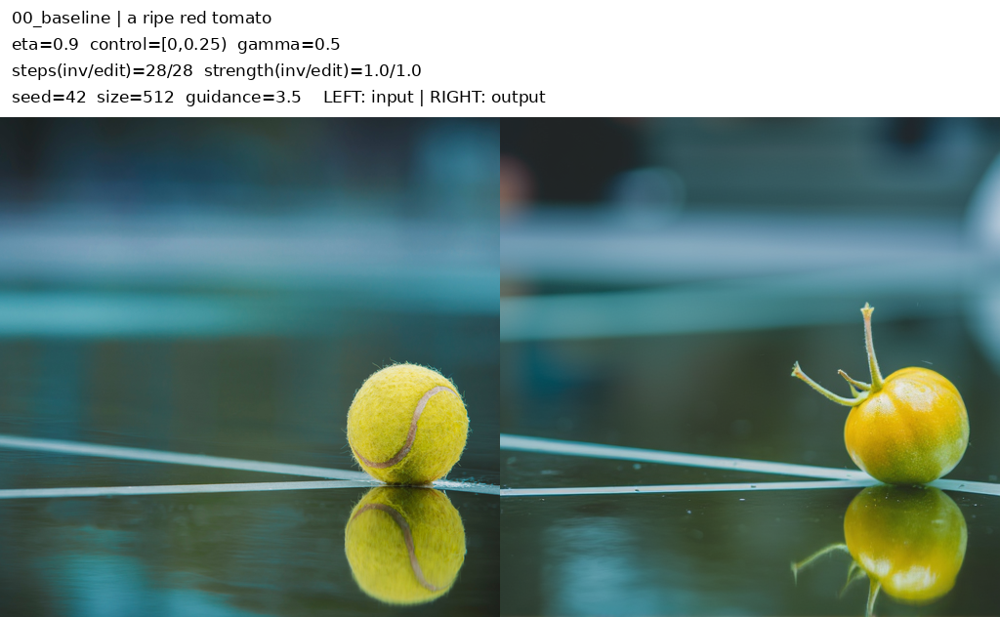

# RF-Inversion Learning Lab

Small, reproducible experiments on **image preservation vs. text-guided editing** with FLUX.1-dev and RF-Inversion.

[Experiments & figures](notes/experiments.md) · [Pipeline notes](notes/pipeline.md) · [Learning log](notes/learning-log.md) · [Run a sweep](simple-lab/README.md)



*Input: a tennis-ball photo. Editing prompt: `a ripe red tomato`. The baseline preserves the scene but retains the yellow subject color.*

## What this explores

| Change | Observed in this example |
|---|---|
| Controller weight `eta` | Stronger preservation also retains unwanted color. |
| Controller duration / position | Longer control reduces editing; later windows can produce ghosting. |
| Inversion weight `gamma` | Changes how much ball-like vs. fruit-like structure remains. |
| API `editing_strength` | Intermediate values can produce granular artifacts. |
| Editing steps | 28 and 56 look similar here; controller step counts also change. |

**Scope:** one input, seed 42, 512×512, A100 40GB. These are exploratory observations, not a benchmark or a complete paper reproduction.

## Run

Use the [setup instructions](notes/setup.md) to prepare the local model, input image, and pinned upstream pipeline. Then:

```bash
cd simple-lab
python run.py --check
python -u run.py
```

Edit three fields in `simple-lab/config.py`:

```python
name = "01_eta_scan"
sweep = "eta"
values = [0, 0.2, 0.4, 0.6, 0.8, 0.9, 1.0]
```

The runner loads the model once, saves each output and its settings, and updates `results/<name>/grid.png`. Completed run directories are never overwritten.

## Repository

```text
simple-lab/   Configuration, sweep runner, usage guide
notes/        Experiment report, implementation notes, learning log, setup
assets/       Figures extracted from the observation report
scripts/      Download and verify the pinned upstream pipeline
source.json   Pipeline version and SHA256
```

Model weights, credentials, environments, and full local runs are excluded from Git.

## Credits

- **Method:** [RF-Inversion](https://github.com/LituRout/RF-Inversion) by Litu Rout et al.; [paper](https://arxiv.org/abs/2410.10792), ICLR 2025.
- **Implementation:** [Diffusers v0.35.1 community ODE pipeline](https://github.com/huggingface/diffusers/blob/v0.35.1/examples/community/pipeline_flux_rf_inversion.py).
- **Base model:** [FLUX.1-dev](https://huggingface.co/black-forest-labs/FLUX.1-dev).
- **Example input:** the [tennis photo](https://www.aiml.informatik.tu-darmstadt.de/people/mbrack/tennis.jpg) linked by the authors.

This repository contributes experiment wrappers and learning notes, developed with AI assistance. It does not claim the underlying method. Upstream code, model weights, and source imagery retain their own terms; no separate license has yet been selected for the added code.
