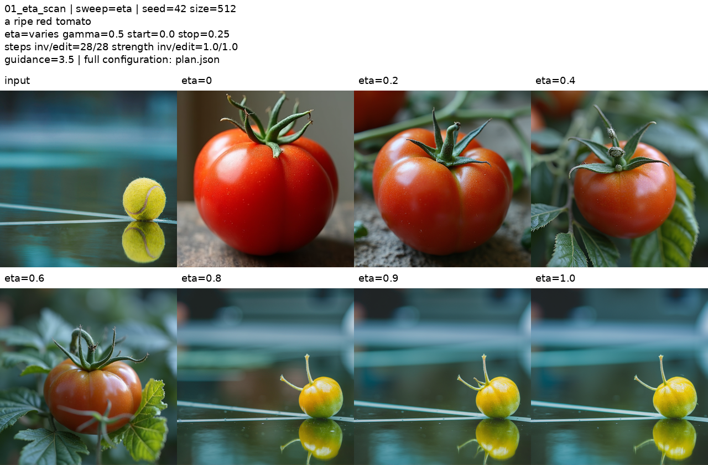
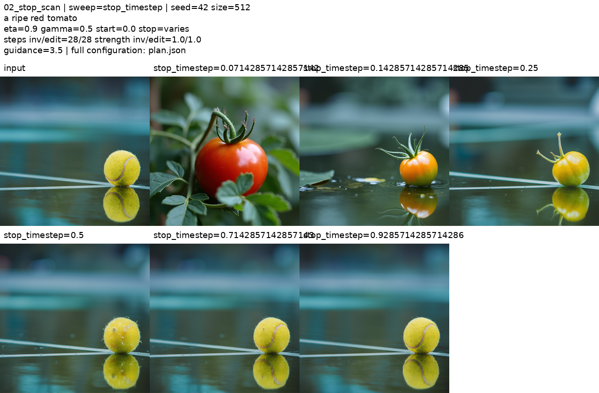
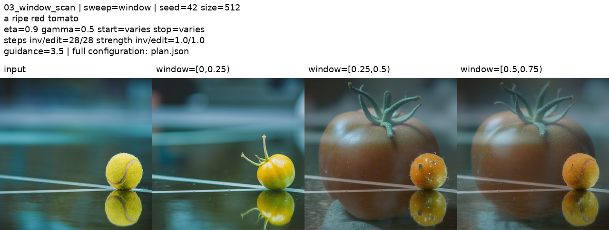
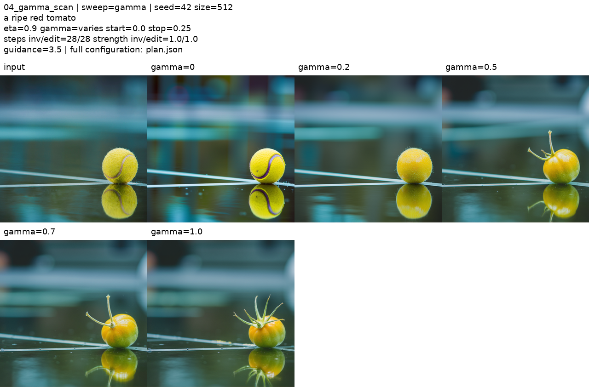
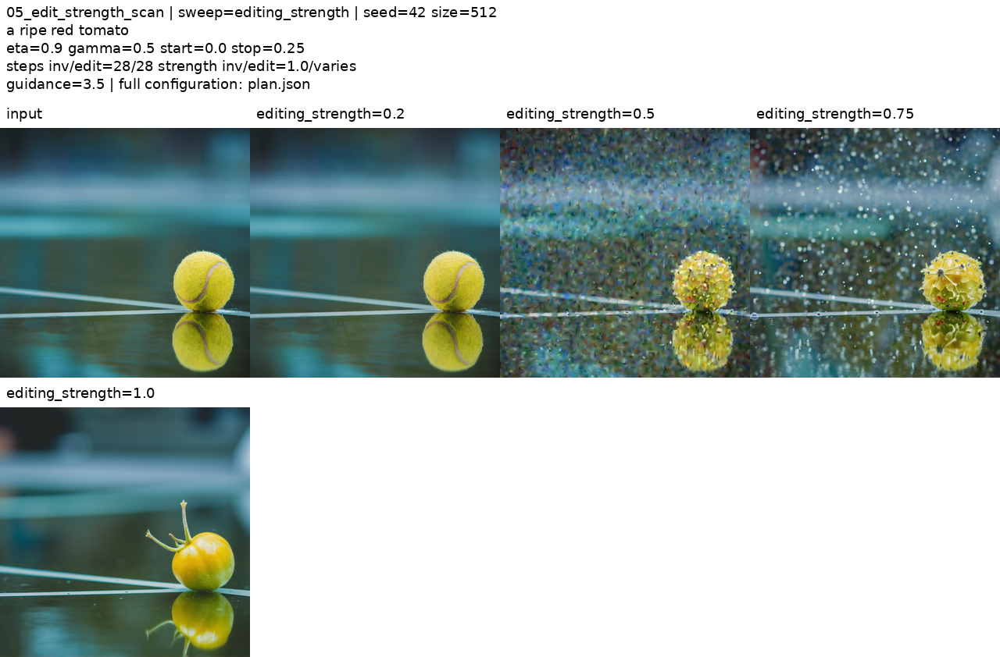
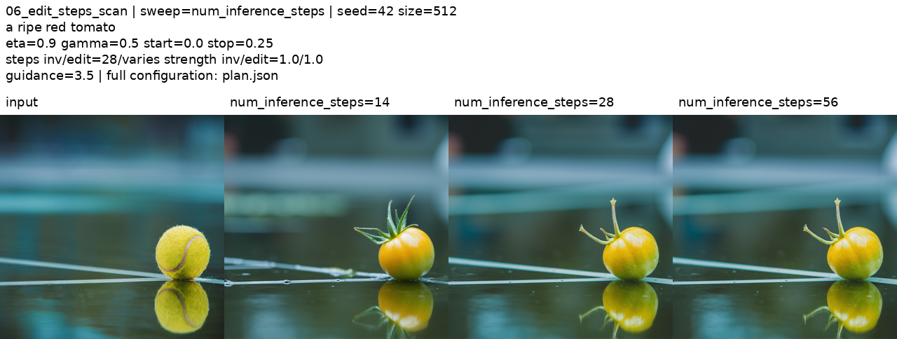

# First-round experiments

**Question:** How do controller settings change the balance between a requested edit and preservation of the source image?

These figures come from existing AutoDL runs, extracted directly from the observation report. They were not regenerated for this repository. Raw per-run JSON records have not yet been imported; settings below are transcribed from the report and runner.

## Baseline

| Setting | Value |
|---|---|
| Input / editing prompt | Tennis-ball photo / `a ripe red tomato` |
| Model / implementation | FLUX.1-dev / Diffusers v0.35.1 community ODE |
| Device / size / seed | A100 40GB / 512×512 / 42 |
| Inversion / editing steps | 28 / 28 |
| `gamma` / `eta` | 0.5 / 0.9 |
| Control interval | [0, 7/28) |
| Inversion / editing strength | 1.0 / 1.0 |
| Source prompt / source guidance | Empty string / 0.0 |
| Editing guidance | 3.5 |

Unless scanned, settings remain at baseline. The input is an image; `a tennis` was not supplied as a source prompt.

## 1. Controller weight

Values: `0, 0.2, 0.4, 0.6, 0.8, 0.9, 1.0`.

**Observation:** Lower values produce a red tomato with substantial changes to subject scale and background. Values of 0.8–1.0 preserve the scene more closely, including the original yellow color.

## 2. Controller duration

Stop values: `2/28, 4/28, 7/28, 14/28, 20/28, 26/28`; start remains zero.

**Observation:** Longer control makes the output increasingly resemble the tennis ball and weakens the requested edit. Original figure labels contain long, overlapping decimals; the ordered values above are the reading key.

## 3. Controller position

Windows: `[0,7/28)`, `[7/28,14/28)`, `[14/28,21/28)`. Each contains seven updates.

**Observation:** Middle and later windows produce a large tomato alongside a smaller object at the original location, with visible ghosting. Equal control duration does not imply equivalent behavior.

## 4. Inversion weight

Values: `0, 0.2, 0.5, 0.7, 1.0`.

**Observation:** Smaller values retain recognizable tennis-ball features. Larger values introduce more fruit and stem structure, without reliably producing the requested red color.

## 5. API editing strength

Values: `0.2, 0.5, 0.75, 1.0`; inversion strength stays at 1.0.

**Observation:** Values of 0.5 and 0.75 produce pronounced granular artifacts; 0.2 resembles the input. This is not a simple monotonic edit-intensity trend.

**Implementation question:** The schedule is truncated while the full inversion endpoint is reused. The resulting state/time alignment and controller fraction need checking; neither is a confirmed explanation of the artifacts. See [pipeline notes](pipeline.md).

## 6. Editing steps

Values: `14, 28, 56`; inversion stays at 28 steps and the cutoff fraction stays at 0.25.

**Observation:** The 14-step run shows more prominent stem/leaf features and changes to the court markings. The 28- and 56-step outputs look similar here.

**Correction:** Controller update counts are **3, 7, and 14**, respectively—not seven in every run. Both strengths are 1.0.

## Limits and next checks

- One image and one seed support case-specific observations only.
- No quantitative comparison or SDE comparison has been completed.
- Check whether later-window ghosting persists across two additional seeds.
- Trace the truncated schedule and inversion state before changing the implementation.
