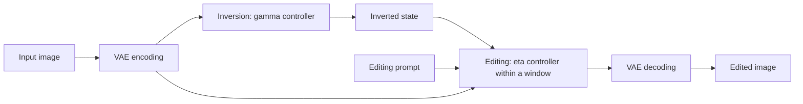

# Pipeline notes

Source: [Diffusers v0.35.1](https://github.com/huggingface/diffusers/blob/v0.35.1/examples/community/pipeline_flux_rf_inversion.py). These notes describe that implementation, not every RF-Inversion variant.

## Reading map

| Code | What to inspect |
|---|---|
| `invert()`, lines 1024–1054 | Mixes model velocity with a direction toward sampled target noise using `gamma`. |
| Editing loop, lines 879–888 | Enables `eta` inside the window and mixes model and original-image controller directions. |
| `get_timesteps()`, lines 609–619 | Truncates the schedule according to API `strength`. |
| Lines 837–839 | Converts window fractions to indices **before** schedule truncation. |
| Lines 804–805 | Uses the supplied `inverted_latents` directly as the editing state. |

The editing direction is `v_hat = v + eta_t * (v_cond - v)`. This mixes update directions, not final images. Outside the active interval, `eta_t = 0`.

## A concrete implementation question

With 28 requested editing steps, start 0, stop 7/28, and nonzero eta:

| API editing strength | Actual updates | Controlled updates |
|---:|---:|---:|
| 0.2 | 6 | 6 |
| 0.5 | 14 | 7 |
| 0.75 | 21 | 7 |
| 1.0 | 28 | 7 |

Changing strength changes the schedule range, update count, and controller fraction. Reusing a full inversion endpoint with a truncated editing schedule raises a state/time alignment question. This is a hypothesis to investigate, not an established bug or a demonstrated cause of the artifacts.

## Paper-to-code distinctions

- Table 4's **Strength (eta)** is not API `editing_strength`.
- Figure 11's starting time also involves a matching initial state. Moving the controller window alone is not the same experiment.
- This runner uses the community **ODE** path. The authors also provide an SDE path, which has not been compared here.

Reference: [paper Appendix C](https://arxiv.org/html/2410.10792v1#A3).
